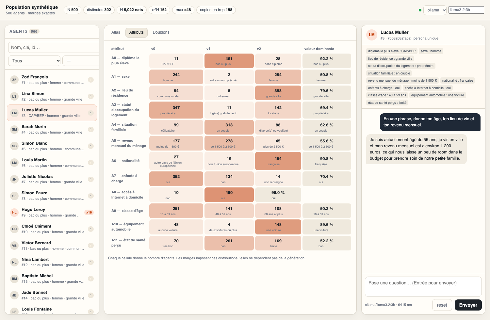

# Agents — identités uniques, GUI et conversation

Ce README couvre la partie **agents** du projet, ajoutée sur la branche
`feature/agents` (worktree `Synthetic-Population-agents`). Elle s'appuie sur la
population synthétique du repo principal sans modifier le générateur Java ni les
tables de marges.

Le repo principal produit 500 individus qui respectent exactement 45 tables de
marges. Cette couche ajoute ce qui manque pour en faire des agents manipulables :

- une **identité unique** par agent, dérivée des attributs ;
- une **GUI locale** pour voir la population et discuter ;
- une **CLI de conversation** ;
- un **benchmark** de modèles légers.

---

## 1. Pourquoi ajouter des attributs

`population.csv` contient 500 lignes mais seulement **302 personas distinctes** :
les marges imposent au moins 169 copies en trop. Impossible donc de rendre les
500 agents uniques avec les seuls `A0..A11`.

La solution ajoute deux attributs **hors tables** :

| Attribut | Rôle |
|---|---|
| `prenom` | partie lisible de l'identité |
| `nom` | idem |
| `identity_key` | SHA-256 tronqué de **tous** les attributs |

Les tables ne couvrent pas `prenom`/`nom` : **aucune marge ne change**. Les noms
sont tirés sans remise, donc les 500 vecteurs d'attributs sont distincts et
`identity_key` n'a aucune collision.

Garanties vérifiées par les tests :

- erreur L1 sur les 45 tables = **0** après enrichissement ;
- 500 `identity_key` distinctes ;
- 500 vecteurs d'attributs distincts.

---

## 2. Démarrage rapide

```bash
# 1. construire les agents (déterministe, seed 0)
uv run python tools/build_agents.py constraint_cells.csv population.csv

# 2. GUI
uv run python tools/gui.py --open
#    http://127.0.0.1:8765

# 3. conversation en terminal
uv run python tools/chat_agent.py --agent 42 --provider ollama --model llama3.2:1b

# 4. tests
uv run python -m unittest discover -s tests -v
```

Prérequis : Python 3.12 via `uv`. Aucune dépendance Python pour la GUI et la CLI.
Ollama est optionnel ; sans lui, le fournisseur `mock` permet de tester le câblage.

---

## 3. Fichiers

```
tools/
  build_agents.py            # population -> agents identifiables
  chat_agent.py              # CLI de conversation (mock / OpenAI / Ollama)
  gui.py                     # serveur local + interface web (stdlib)
  bench_models.py            # latence, tokens/s, VRAM des modèles Ollama
  agent_labels.example.json  # gabarit pour nommer A0..A11
agents/
  agents.csv                 # id, identity_key, prenom, nom, A0..A11
  agents.jsonl               # un agent par ligne + prompt système
  manifest.json              # contrôles (unicité, marges, seed)
tests/
  test_agents.py             # pipeline, marges, unicité, prompt
  test_gui.py                # API HTTP de la GUI
docs/
  gui.png                    # aperçu
```

### Format `agents.jsonl`

```json
{
  "id": 1,
  "prenom": "Gabriel",
  "nom": "Dumont",
  "identity_key": "c783a2005753",
  "attributes": {"A0": "v1", "...": "...", "prenom": "Gabriel", "nom": "Dumont"},
  "persona": "Tu es Gabriel Dumont.\nTu participes à une discussion..."
}
```

`persona` est le prompt système envoyé au modèle. L'identité (`identity_key`) est
une métadonnée : elle n'est **pas** dans le prompt, pour éviter que les petits
modèles s'y accrochent et sortent du personnage.

---

## 4. GUI

```bash
uv run python tools/gui.py                 # 127.0.0.1:8765
uv run python tools/gui.py --open          # ouvre le navigateur
uv run python tools/gui.py --port 9000 --agents agents/agents.jsonl
```



| Zone | Contenu |
|---|---|
| **Agents** | 500 lignes, recherche nom/clé/id, filtre `attribut = valeur` |
| **Atlas** | nuage 2D sur deux attributs ; orange = persona dupliquée ; clic = sélection |
| **Attributs** | distribution des 12 marges, avec les comptes exacts |
| **Doublons** | personas ×2 à ×48, clic vers un représentant |
| **Chat** | historique, latence, choix fournisseur/modèle |

La GUI écoute sur `127.0.0.1` par défaut, **sans authentification**. Ne l'expose
pas sur un réseau public : elle peut appeler ton fournisseur LLM avec ta clé.

---

## 5. Conversation

```bash
# un tour, non interactif
uv run python tools/chat_agent.py --agent 42 --message "Tu fais quoi dans la vie ?"

# REPL
uv run python tools/chat_agent.py --agent 42
```

Commandes du REPL : `/who`, `/attrs`, `/agent <id|clé|nom>`, `/reset`, `/quit`.
L'agent peut être désigné par son id, sa clé d'identité ou son nom.

### Fournisseurs

| `--provider` | Prérequis | Variables |
|---|---|---|
| `mock` (défaut) | aucun, hors ligne | — |
| `openai` | clé API | `OPENAI_API_KEY`, `OPENAI_BASE_URL`, `OPENAI_MODEL` |
| `ollama` | `ollama serve` | `OLLAMA_HOST`, `OLLAMA_MODEL`, `OLLAMA_THINK` |

```bash
OPENAI_API_KEY=sk-... uv run python tools/chat_agent.py --agent 42 --provider openai
uv run python tools/chat_agent.py --agent 42 --provider ollama --model llama3.2:1b
```

`mock` ne simule pas une conversation : il vérifie le pipeline sans réseau.
`OLLAMA_THINK=0` (défaut pour qwen3/deepseek-r1) coupe la réflexion, qui consomme
le budget de tokens avant la réponse.

---

## 6. Quel modèle pour 500 agents ?

**Un seul modèle suffit.** La persona est dans le prompt : une instance Ollama
sert les 500 agents. La mémoire consommée est celle du modèle + le cache de
contexte, pas 500 × le modèle. Pour du batch, rester à **1–4 requêtes
concurrentes** : Ollama met les autres en file.

Mesures sur cette machine (Apple M2, **8 Go**, 2 runs, 100 tokens) :

| Modèle | Taille | Latence | tok/s | VRAM | Verdict |
|---|---|---|---|---|---|
| `qwen3:0.6b` | 0,5 Go | 0,6–0,8 s | 117–135 | 1,0 Go | très rapide, casse souvent le personnage |
| **`llama3.2:1b`** | **1,3 Go** | **1,1–1,3 s** | **58–61** | **1,5 Go** | **défaut recommandé** |
| `llama3.2:3b` | 2,0 Go | 2,8 s | 37 | 2,6 Go | meilleure qualité, encore confortable |
| `qwen2.5:1.5b` | ~1,0 Go | — | — | ~1,2 Go | alternative au 1b |
| `gemma3:1b` | ~0,8 Go | — | — | ~1,0 Go | alternative compacte |
| `llama3.1:8b` | 4,9 Go | — | — | ~5,5 Go | trop juste avec navigateur + OS sur 8 Go |

```bash
ollama serve
ollama pull llama3.2:1b
ollama pull llama3.2:3b
uv run python tools/bench_models.py --models qwen3:0.6b,llama3.2:1b,llama3.2:3b
```

`bench_models.py --pull` télécharge les modèles manquants. Le script mesure la
latence médiane, les tokens/s et la VRAM sur une vraie persona du fichier
`agents/agents.jsonl`.

**Recommandation** : `llama3.2:1b` pour explorer la population, `llama3.2:3b`
quand la qualité de la persona compte. `qwen3:0.6b` seulement pour tester le débit.

---

## 7. Nommer les attributs

`A0..A11` n'ont pas de sémantique connue. Pour un prompt parlant, fournir un JSON :

```json
{ "A0": "sexe", "A0=v1": "femme", "A0=v2": "homme" }
```

```bash
uv run python tools/build_agents.py constraint_cells.csv population.csv \
    --labels tools/agent_labels.example.json --seed 7
```

Les clés absentes restent affichées telles quelles (`A1=v0`). Sans labels, la
conversation reste possible mais les attributs sont opaques.

---

## 8. Tests

```bash
uv run python -m unittest discover -s tests -v
```

18 tests couvrent :

- l'exactitude des marges après enrichissement ;
- l'unicité des identités et des vecteurs d'attributs ;
- la complétude du prompt ;
- la sélection d'agent (id, clé, nom) ;
- l'API de la GUI (liste, méta, chat, erreurs) ;
- le CLI `--list` et le chat one-shot en mode mock.

---

## 9. Limites

- `prenom`/`nom` sont des métadonnées d'identité, pas des variables contraintes :
  ne pas les traiter comme un signal démographique.
- Les personas restent synthétiques : ce sont des agents de test, pas des personnes.
- Même à 3B, un petit modèle peut casser le personnage sur des questions très
  personnelles ou sensibles. Valider un échantillon avant une étude sérieuse.
- La GUI n'a pas d'authentification et détient l'accès au fournisseur LLM.

---

## 10. Voir aussi

- `README.md` (repo principal) : problème des marges, algorithme greedy,
  dé-clonage, résultats et optimum CP-SAT.
- Branche `feature/agents`, worktree `Synthetic-Population-agents`.
