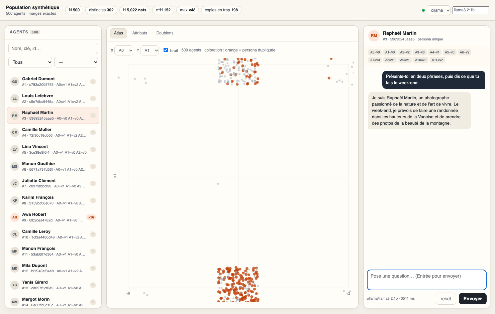

# Agents identifiables et interrogeables

Branche `feature/agents`, worktree externe `Synthetic-Population-agents`.
Elle ne modifie **ni** le générateur Java, **ni** les tables de marges.

## Pourquoi ajouter des attributs

`population.csv` contient 500 individus mais seulement **302 personas distinctes** :
les 45 tables imposent au moins 169 copies en trop. Une identité unique ne peut donc
pas être construite avec les seuls `A0..A11`.

On ajoute deux attributs **hors tables** — `prenom`, `nom` — tirés sans remise :

- aucune marge ne change (les tables ne les couvrent pas) ;
- les 500 vecteurs d'attributs deviennent distincts ;
- `identity_key` est un SHA-256 tronqué de **tous** les attributs, donc l'identité
  est dérivée des attributs, pas d'un compteur arbitraire.

## Utilisation

```bash
# 1. construire les agents (déterministe, seed 0)
uv run python tools/build_agents.py constraint_cells.csv population.csv

# 2. vérifier
uv run python -m unittest discover -s tests -v

# 3. lister / choisir
uv run python tools/chat_agent.py --list
uv run python tools/chat_agent.py --agent 42 --message "Tu fais quoi dans la vie ?"
uv run python tools/chat_agent.py --agent 42          # conversation interactive
```

La conversation garde l'historique, `/reset` l'efface, `/agent <id|clé|nom>` change
d'agent, `/attrs` réaffiche le profil.

## GUI locale



```bash
uv run python tools/gui.py --open
# http://127.0.0.1:8765
```

Zéro dépendance (stdlib). Trois zones :

- **Agents** : 500 lignes, recherche (nom, clé, id), filtre attribut = valeur.
- **Atlas** : nuage 2D sur deux attributs au choix ; orange = persona dupliquée ;
  clic sur un point = sélection. Onglets **Attributs** (distribution des marges)
  et **Doublons** (personas ×2 à ×48).
- **Chat** : prompt système construit côté serveur, historique, latence, choix
  du fournisseur et du modèle dans l'en-tête.

Sécurité : écoute sur `127.0.0.1` par défaut, sans authentification. Ne l'expose
pas sur un réseau public.

## Choix du modèle : un seul modèle pour 500 agents

Erreur classique : croire qu'il faut « un LLM par agent ». La persona est dans le
prompt ; **une seule instance de modèle** sert les 500 agents. La mémoire consommée
est celle du modèle + le cache de contexte, pas 500 × le modèle.

Sur une machine **8 Go (M2)**, cibler ≤ 2,5 Go en Q4 laisse de la place au système
et au navigateur. Mesures faites ici avec `tools/bench_models.py` (2 runs, 100 tokens) :

| Modèle Ollama | Taille | Latence | tok/s | VRAM | Verdict |
|---|---|---|---|---|---|
| `qwen3:0.6b` | 0,5 Go | 0,6–0,8 s | 117–135 | 1,0 Go | très rapide, mais sort souvent du personnage |
| **`llama3.2:1b`** | **1,3 Go** | **1,1–1,3 s** | **58–61** | **1,5 Go** | **meilleur compromis interactif sur 8 Go** |
| **`llama3.2:3b`** | **2,0 Go** | **2,8 s** | **37** | **2,6 Go** | **meilleure qualité, encore confortable** |
| `qwen2.5:1.5b` | ~1,0 Go | non mesuré | — | ~1,2 Go | alternative au 1b |
| `gemma3:1b` | ~0,8 Go | non mesuré | — | ~1,0 Go | alternative compacte |
| `llama3.1:8b` | 4,9 Go | — | — | ~5,5 Go | trop juste avec navigateur + OS sur 8 Go |

```bash
ollama serve
ollama pull llama3.2:1b          # interactif rapide
ollama pull llama3.2:3b          # qualité
uv run python tools/bench_models.py --models qwen3:0.6b,llama3.2:1b,llama3.2:3b
uv run python tools/gui.py --provider ollama --model llama3.2:1b
```

**Recommandation** : `llama3.2:1b` par défaut pour explorer la population,
`llama3.2:3b` quand la qualité de la persona compte. `qwen3:0.6b` uniquement pour
tester le débit. Pour 500 agents, rester à **1–4 requêtes concurrentes** : Ollama
met les autres en file. Le nombre de modèles n'augmente pas avec le nombre d'agents.

Limite connue : même à 3B, un petit modèle peut casser le personnage sur des
questions très personnelles ou sensibles. Ce sont des agents de test, pas des
personnes.

## Fournisseurs LLM

| `--provider` | Prérequis | Variables |
|---|---|---|
| `mock` (défaut) | aucun, hors ligne | — |
| `openai` | clé API | `OPENAI_API_KEY`, `OPENAI_BASE_URL`, `OPENAI_MODEL` |
| `ollama` | `ollama serve` | `OLLAMA_HOST`, `OLLAMA_MODEL` |

```bash
OPENAI_API_KEY=sk-... uv run python tools/chat_agent.py --agent 42 --provider openai
uv run python tools/chat_agent.py --agent 42 --provider ollama --model llama3.1
```

`mock` ne simule pas une conversation : il sert à tester le câblage du pipeline.

## Fichiers produits (`agents/`)

| Fichier | Contenu |
|---|---|
| `agents.csv` | `id, identity_key, prenom, nom, A0..A11` |
| `agents.jsonl` | un agent par ligne : attributs + `persona` (prompt système) |
| `manifest.json` | contrôles : unicité, erreur de marges, seed |

## Libellés lisibles

`A0..A11` n'ont pas de sémantique connue. Pour un prompt parlant, fournis un JSON :

```json
{ "A0": "sexe", "A0=v1": "femme", "A0=v2": "homme" }
```

```bash
uv run python tools/build_agents.py constraint_cells.csv population.csv \
    --labels tools/agent_labels.example.json --seed 7
```

Les clés absentes restent affichées telles quelles (`A1=v0`).

## Garanties

- Erreur L1 sur les 45 tables = **0** après enrichissement (testé).
- 500 `identity_key` distinctes et 500 vecteurs d'attributs distincts (testé).
- Le CSV enrichi reste lisible par `CheckPopulation` : les colonnes en trop sont ignorées.

## Limites

- `prenom`/`nom` sont des métadonnées d'identité, pas des variables contraintes :
  ne les utilise pas comme signal démographique.
- Le prompt système est volontairement générique tant que les `A*` ne sont pas nommés.
- Les personas restent des échantillons synthétiques : ce sont des agents de test,
  pas des personnes réelles.
